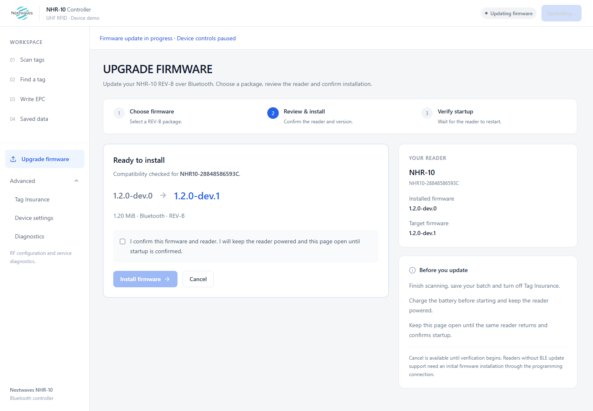
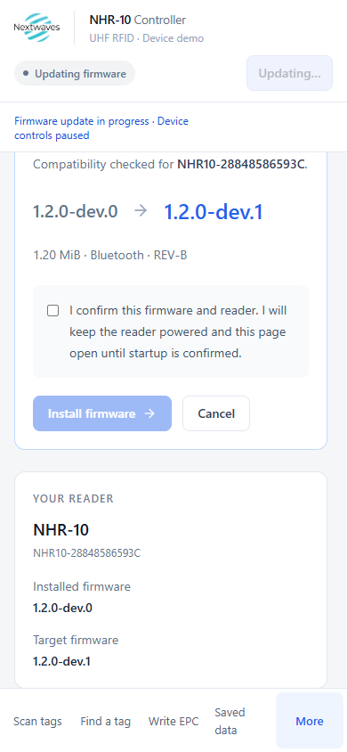

# REV-B web BLE OTA validation

Recorded on 2026-11-16 for the local implementation in
`D:/Firmware-Develop/NHR10-APP/NHR10-APP-VERSION-B`.

## Scope and environment

The VER-C web project at `../nw-ble-handheld-main` supplied the BLE protocol-v1
implementation. The integration targets the OTA firmware in
`D:/Firmware-Develop/NHR-10-REVB`, including REV-B hardware code 2, 3 MiB slots,
legacy name-only DI and the existing REV-B controller command queue. The reference
project was read only. These local checks did not flash firmware; deployment is
tracked separately through the repository's Vercel integration.

Environment: Windows, Node.js v24.16.0, Chrome 157.0.8103.78, Playwright 1.65.1,
Vitest 5.0.0, Vite 6.4.2. Browser checks ran against the normal App entry point on
localhost with a simulated Web Bluetooth peripheral injected by Playwright.
The fixture is not imported into the app or its production bundle.

## Completed checks

| Check | Result |
| --- | --- |
| Existing tests before changes | 331 passed, 16 files |
| TypeScript, `npm run lint` | Passed |
| Full suite with `NHR_OTA_PACKAGE` set, `npm test` | 395 passed, 23 files |
| Release coverage, `npm run test:coverage` | Passed existing gates: statements 73.08%, branches 71.50%, functions 72.86%, lines 74.37% |
| Production build, `npm run build` | Passed; main JS 440.07 kB, gzip 136.03 kB |
| Chrome, `npm run test:ota-browser` | 8 scenarios passed, no browser page errors |
| Tracked diff whitespace, `git diff --check` | Passed |

Unit/integration coverage exercises target/hash/descriptor/length validation,
semantic versions and explicit downgrade, malformed Info/Status, MTU-dependent
frames, durable ACKs, exclusive ownership, queue draining and timeouts, cancellation,
unknown FINISH outcomes, startup/rollback checks, legacy DI identity, controller
polling/reconnect suspension, and consent/UI states. The test that reads the built
package compares every image byte using native binary equality.

The optional approved-release path is covered with mocked HTTPS responses: exact
record/package size and hash, REV-B metadata, redirect policy, bounded streaming,
invalid records and errors. No actual approved-release endpoint is configured or
claimed to have been tested.

## Built package used by the tests

Source file:
`D:/Firmware-Develop/NHR-10-REVB/artifacts/ota-ble/NHR10-B-1.2.0-dev.1.nhrota`

| Field | Value |
| --- | --- |
| Version | `1.2.0-dev.1` |
| Project | `gatt_server_demos` |
| Package size | 1,253,548 bytes |
| Application size | 1,253,440 bytes |
| Manifest hardware code | 2, REV-B |
| Image SHA-256 | `c6f7382d5539db9fe2ae39a0668d726b64c87b453fe679b29816501990818656` |
| Package SHA-256 | `ae96911a2fb7125116eb55bbb399e893f57b47c7c273ac621913d4aaba854690` |

## Chrome scenarios

1. Select the built package in the actual app, prepare/review without OTA writes,
   require consent, transfer all 1,253,440 application bytes, verify their SHA-256,
   reconnect and wait for the target version with startup confirmed. The simulated
   peripheral observed 7,377 frames (manifest, BEGIN, 7,374 DATA, FINISH), unique
   sequences, one picker, no overlapping GATT operations and no RFID commands
   during the OTA lease. Starting a scan after confirmation sent the normal `S`
   command, proving controller recovery through the app.
2. At 390 × 844, open More → Upgrade firmware, select/review and cancel without
   sending any OTA frame. No horizontal page overflow. Install remains disabled
   without consent; the review and controls remain usable by scrolling.
3. Change the package hardware code to REV-C: reject locally before preparation
   and before any OTA write.
4. Reject BEGIN for low power: show the firmware rejection and send no DATA.
5. Reboot to the previous version: report possible rollback; never claim success.
6. Lose the FINISH response after commit: confirm via post-boot Info without ABORT.
7. Cancel while waiting for a durable DATA ACK: release safely without FINISH.
8. Connect older firmware without the OTA service: explain the initial OTA-enabled
   application and bootloader installation requirement.

The complete run report and regenerated screenshots are in ignored
`test-results/ota/`. Review captures are retained below; both use simulated device
state, not a connected physical reader.

## Remaining hardware acceptance

These results verify the web application and protocol handling against simulated
GATT. They do not establish radio throughput, actual firmware flash/rollback, power
continuity, or phone/browser compatibility on a physical reader. Run the hardware
acceptance steps in [the upgrade guide](firmware-upgrade.md) and the firmware
workspace's `docs/OTA_BLE.md` before accepting a device release. Once the device
is bootstrapped on `1.2.0-dev.1`, use a distinct candidate version for its next OTA.
